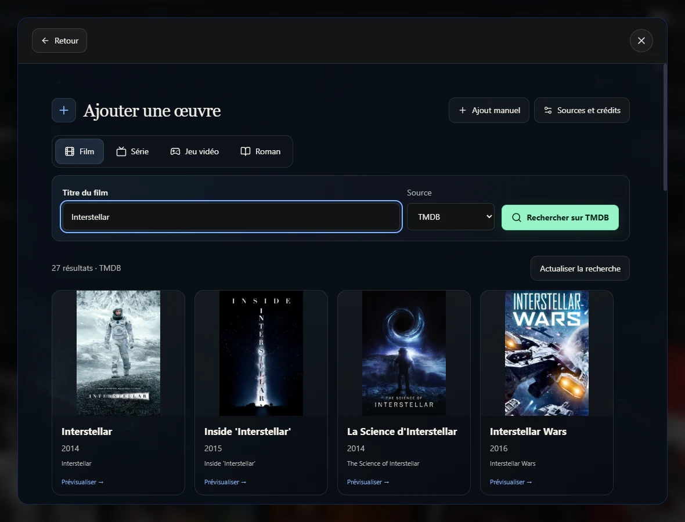
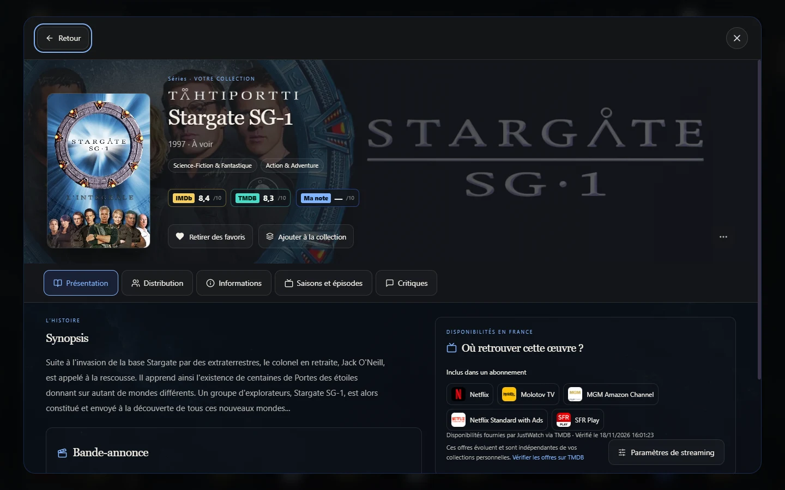
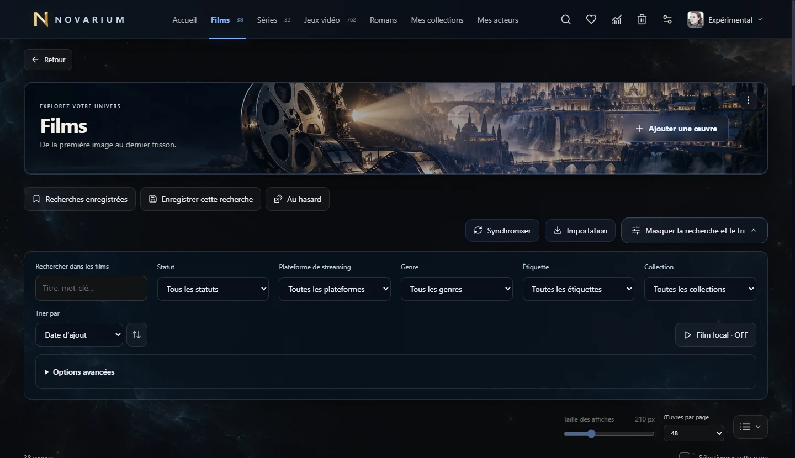
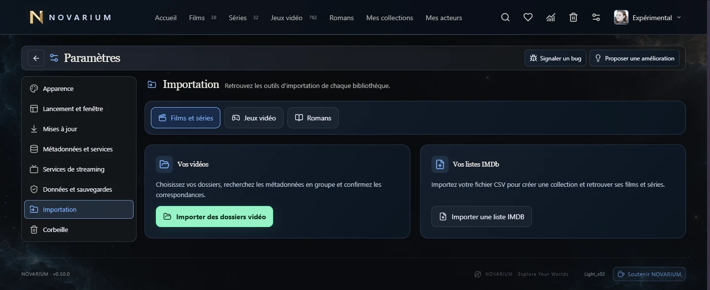
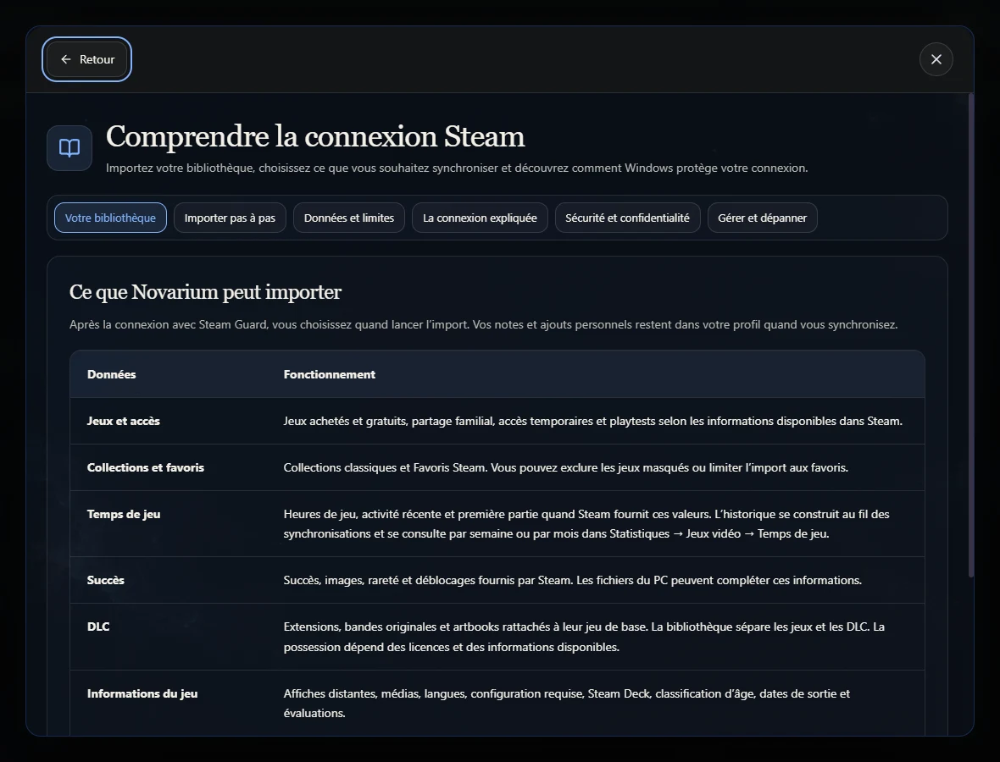
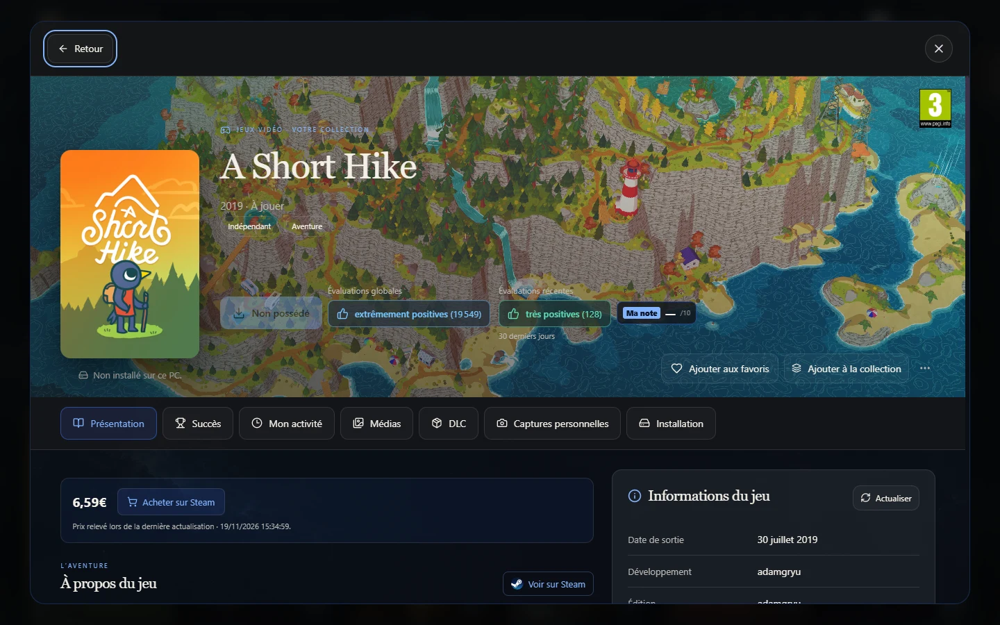
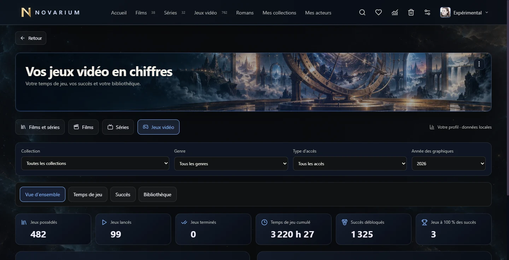
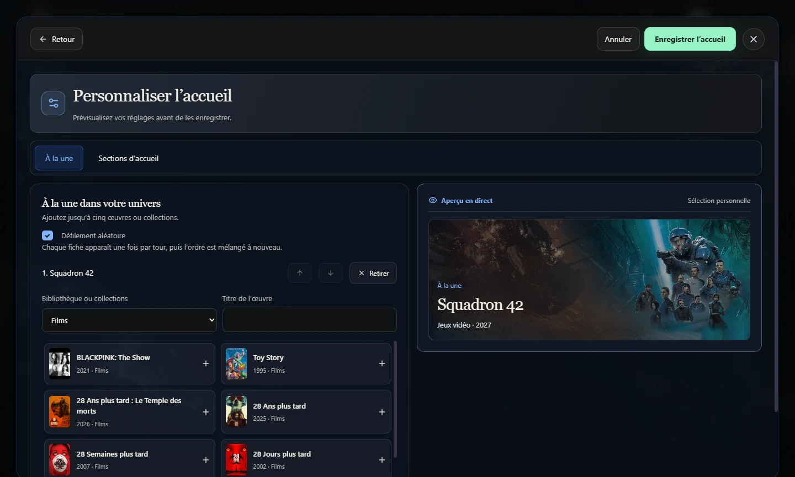
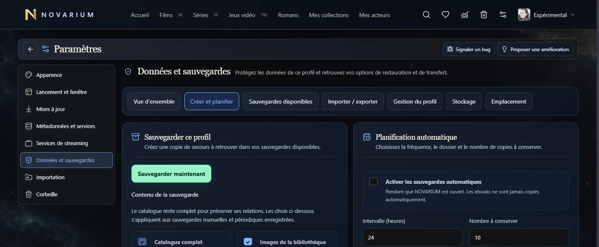

<h1 align="center">NOVARIUM</h1>

<strong>Explore Your Worlds</strong> Votre bibliothèque de films, séries, jeux vidéo et romans sur Windows.

<a href="https://github.com/Light-x02/Novarium/releases/latest">Télécharger NOVARIUM</a> · <a href="#tutoriels-en-images">Tutoriels en images</a> · <a href="INSTALLATION.md">Guide d’installation</a> · <a href="ROADMAP.md">Feuille de route</a>

NOVARIUM est une application Windows gratuite et propriétaire. Organisez vos œuvres, retrouvez votre progression et partagez une collection ou sauvegardez un profil. Vos données sont conservées sur votre ordinateur.

**Version stable [0.51.1](https://github.com/Light-x02/Novarium/releases/tag/v0.51.1)** · **Windows 11 x64 testé** · [Prérequis et compatibilité](INSTALLATION.md#configuration-windows)

## Pour commencer

1. Téléchargez le ZIP depuis les [versions officielles](https://github.com/Light-x02/Novarium/releases/latest) et extrayez-le entièrement dans un dossier accessible en écriture.
2. Ouvrez `NOVARIUM.exe` depuis le dossier extrait. Gardez `_internal` et les autres ressources à côté du programme.
3. Créez un profil. Le **Guide de bienvenue et clés API** vous accompagne si vous souhaitez configurer les fournisseurs de métadonnées.

Vous utilisez déjà NOVARIUM ? Ouvrez **Paramètres → Mises à jour** pour rechercher la dernière version. Le [guide d’installation](INSTALLATION.md#mettre-à-jour) détaille le téléchargement, la migration et la vérification de signature.

## Tutoriels en images

<strong>Afficher les neuf tutoriels</strong>

Cliquez sur un titre pour ouvrir ou refermer le tutoriel. Les captures montrent la bibliothèque Expérimental utilisée pour tester NOVARIUM.

### Films, séries et collections

<strong>Ajouter une œuvre et choisir ses informations</strong>

1. Cliquez sur **Ajouter une œuvre** depuis l’accueil ou une bibliothèque.
2. Choisissez **Film**, **Série**, **Jeu vidéo** ou **Roman**, puis recherchez le titre. Vous pouvez aussi utiliser **Ajout manuel**.
3. Ouvrez le bon résultat, vérifiez le titre, l’année et les informations proposées, puis enregistrez la fiche. Pour une série, les saisons et épisodes sont également importés lorsque leur récupération est activée et disponible.

<strong>Suivre une série et retrouver ses plateformes de streaming</strong>

1. Ouvrez une fiche dans **Séries**, puis l’onglet **Saisons et épisodes**. Choisissez une saison et indiquez les épisodes vus pour suivre votre progression.
2. Revenez dans **Présentation** pour consulter le synopsis, les notes et les disponibilités par plateforme lorsqu’elles sont fournies.
3. Dans **Paramètres → Services de streaming**, choisissez vos plateformes favorites et leur ordre. L’affiche privilégie la première plateforme favorite qui propose l’œuvre.

<strong>Organiser ses collections et enregistrer une recherche</strong>

1. Dans **Mes collections**, créez une collection. Depuis la fiche d’une œuvre, cliquez sur **Ajouter à la collection** pour l’y ranger.
2. Dans une bibliothèque, ouvrez **Recherche et tri**. Combinez le titre, les filtres et le tri qui vous intéressent.
3. Cliquez sur **Enregistrer cette recherche** pour retrouver ces critères dans **Recherches enregistrées**. Le résultat évolue avec la bibliothèque.

<strong>Importer les films et séries d’un dossier du PC</strong>

1. Ouvrez **Paramètres → Importation → Films et séries**, puis **Importer des dossiers vidéo**.
2. Choisissez la catégorie **Films** ou **Séries**, utilisez **Ajouter un dossier**, puis lancez l’analyse.
3. Contrôlez les titres trouvés et les correspondances proposées avant de valider. Une fois le fichier associé, vous pouvez le lire depuis sa fiche dans votre lecteur Windows.

NOVARIUM conserve l’association avec la vidéo à son emplacement d’origine. Utilisez **Importer une liste IMDb** dans le même onglet si vous partez d’un fichier CSV IMDb.

### Jeux vidéo et Steam

<strong>Connecter Steam et importer sa bibliothèque</strong>

1. Ouvrez **Paramètres → Importation → Jeux vidéo → Importer Steam**. **Comprendre la connexion Steam** détaille les données importées et les protections disponibles.
2. Cliquez sur **Connecter Steam**. Choisissez la protection de la session, puis connectez-vous via le **QR code Steam Guard** ou votre identifiant et votre mot de passe. Le coffre Windows protège la session, avec un renfort TPM facultatif sur un PC compatible.
3. Choisissez vos options d’import, dont la **liste de souhaits** si vous la voulez, puis lancez **Importer ma bibliothèque**. Utilisez **Synchroniser** pour les actualisations suivantes.

Les collections **Favoris Steam** et **Liste de souhaits Steam** suivent vos choix dans Steam.

<strong>Explorer la fiche d’un jeu, ses médias et ses DLC</strong>

1. Dans **Jeux vidéo**, ouvrez une fiche. La bannière rassemble les commandes disponibles selon l’accès au jeu et son installation.
2. Parcourez **Succès**, **Mon activité**, **Médias** et **DLC**. Les informations disponibles dépendent du jeu et de la dernière synchronisation.
3. Pour une extension, choisissez **DLC** dans la bibliothèque. La fiche indique la possession et, quand Steam le fournit, le jeu de base requis. Le jeu de base sert à lancer le contenu.

<strong>Consulter ses statistiques de jeu et de visionnage</strong>

1. Cliquez sur l’icône **Statistiques personnelles** dans la barre du haut.
2. Ouvrez **Jeux vidéo** pour consulter **Vue d’ensemble**, **Temps de jeu**, **Succès** et **Bibliothèque**. Les relevés hebdomadaires et mensuels se constituent au fil des synchronisations Steam.
3. Dans les statistiques **Films et séries**, retrouvez votre suivi de visionnage, vos goûts, vos notes et votre activité.

### Accueil et données

<strong>Personnaliser l’accueil et les œuvres à la une</strong>

1. Cliquez sur **Personnaliser l’accueil** pour choisir les sections visibles et organiser vos collections épinglées.
2. Dans la bannière, ouvrez **Choisir la une**. Sélectionnez les œuvres, une bibliothèque ou les œuvres d’une collection.
3. Activez le mode aléatoire pour faire défiler la sélection. Une même œuvre revient après que les autres ont défilé.

<strong>Sauvegarder un profil ou exporter une collection</strong>

1. Ouvrez **Paramètres → Données et sauvegardes → Créer et planifier**. Choisissez le contenu de la sauvegarde, puis cliquez sur **Sauvegarder maintenant** ou configurez la planification.
2. Retrouvez vos copies dans **Sauvegardes disponibles**. Cet écran permet de vérifier une copie ou de lancer sa restauration.
3. Pour changer de PC ou transférer une sélection, ouvrez **Importer / exporter** et choisissez **Profil complet** ou **Une ou plusieurs collections**. L’option des liens vidéo conserve les associations. Les fichiers vidéo restent sur le disque d’origine.

## Ce que NOVARIUM organise

| Bibliothèque | Fonctions principales |
| --- | --- |
| **Films** | Affiches, synopsis, distribution, notes, favoris, suivi, fichiers vidéo locaux et offres de streaming. |
| **Séries** | Saisons et épisodes, progression, distribution, notes et suivi des nouvelles saisons. |
| **Jeux vidéo** | Jeux et DLC, métadonnées Steam, synchronisation facultative, installations, captures, succès, statuts de jeu et statistiques. |
| **Romans** | Livres papier et numériques, éditions, sagas, tomes et progression. L’import de fichiers ebooks est suspendu pendant la préparation de la refonte. |

Chaque profil dispose de son propre dossier de données et conserve ses collections, favoris et préférences. Les sauvegardes restent séparées et peuvent être restaurées depuis l’écran des profils. Une fois enregistrée, la bibliothèque est consultable hors ligne. La recherche de métadonnées, les visuels distants, les mises à jour et les synchronisations utilisent Internet. [Confidentialité](CONFIDENTIALITE.md) · [Conditions d’utilisation](MENTIONS_LEGALES.md)

## Nouveautés de la 0.51.1

- Retirez un profil indisponible du sélecteur en conservant ses fichiers. Les sauvegardes accessibles restent disponibles pour la restauration.
- Après un import IMDb, ouvrez la collection directement depuis le bilan. Les compteurs se mettent à jour pendant l’import.
- La synchronisation Steam préserve le temps de jeu connu si la durée manque. La vérification du QR code reprend après une interruption temporaire.
- Depuis le menu d’une affiche, choisissez de mettre la fiche à la corbeille ou de la supprimer définitivement après confirmation.

[Notes complètes de la 0.51.1](https://github.com/Light-x02/Novarium/releases/tag/v0.51.1)

## Sources et crédits

**Films et séries** via TMDB et IMDb via OMDb. **Jeux** via Steam, avec IGDB en recherche complémentaire. **Livres** via Google Books et Open Library. **Traduction facultative** via DeepL. Les disponibilités en France reposent sur TMDB/JustWatch. Certains fournisseurs nécessitent vos propres identifiants API.

NOVARIUM utilise l’API TMDB et bénéficie des données et illustrations de fournisseurs tiers. Les marques et visuels appartiennent à leurs titulaires. La [page des crédits et composants tiers](TIERS.md) détaille leurs conditions et licences.

## Aide et communauté

- Pour une question, consultez [Questions et aide](https://github.com/Light-x02/Novarium/discussions/categories/questions-et-aide).
- Pour une fonctionnalité, partagez votre proposition dans [Idées et suggestions](https://github.com/Light-x02/Novarium/discussions/categories/id%C3%A9es-et-suggestions).
- Pour un bug, [ouvrez un signalement](https://github.com/Light-x02/Novarium/issues/new) avec la version de NOVARIUM, la version de Windows et les étapes suivies. Anonymisez vos captures et gardez vos clés, jetons et sauvegardes privés.

Vous pouvez soutenir le développement depuis le lien **Soutenir NOVARIUM** dans l’application ou sur [Ko-fi](https://ko-fi.com/light_x02).

---

NOVARIUM · Créé par **Light_x02** · Logiciel propriétaire gratuit.
