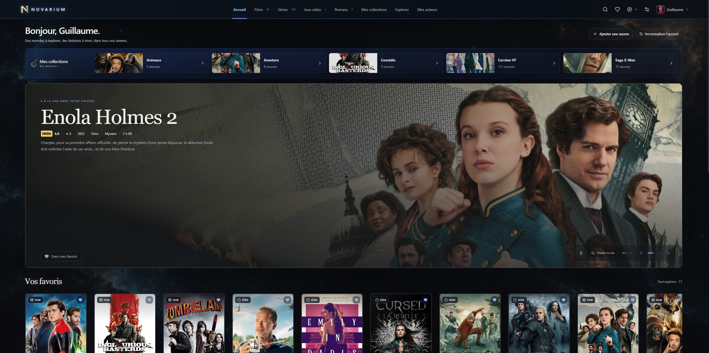

<h1 align="center">NOVARIUM</h1>

<strong>Explore Your Worlds</strong> Vos films, vos séries, vos jeux et vos lectures. Un même univers.

<a href="https://github.com/Light-x02/Novarium/releases/latest">Télécharger la version stable</a> · <a href="INSTALLATION.md">Installer NOVARIUM</a> · <a href="https://github.com/Light-x02/Novarium/issues">Signaler un problème</a> · <a href="https://ko-fi.com/light_x02">Faire un don</a>

---

**NOVARIUM est une application Windows gratuite et propriétaire pour organiser vos collections personnelles.** Une interface immersive, des profils indépendants et des données conservées sur votre ordinateur.

**Version actuelle : [0.46.0](https://github.com/Light-x02/Novarium/releases/tag/v0.46.0).**

## Quatre bibliothèques, toutes vos histoires

| Votre univers | Ce que vous pouvez organiser |
| --- | --- |
| **Films et séries** | Affiches, synopsis, distribution, saisons et épisodes, notes, favoris, statuts et suivi de visionnage. |
| **Jeux vidéo** | Couvertures, plateformes, studios, statuts et temps de jeu saisi manuellement. |
| **Romans** | Livres papier et numériques, éditions, fichiers associés, sagas, tomes et progression de lecture. Un indicateur manuel permet de repérer les livres présents sur votre liseuse. |
| **Collections** | Sous-collections, recherche, filtres, tri, ordre personnel et sélections mises en avant sur l’accueil. |

## Un espace qui vous ressemble

- **Accueil personnalisable** : œuvres à la une, sections réorganisables et collections du moment.
- **Métadonnées et illustrations** : recherche et prévisualisation avant import, choix d’images, recadrage et modifications personnelles.
- **Profils distincts** : collections, favoris et suivis séparés, avatar et préférences propres à chaque profil. Duplication, gestion du stockage et suppression avec confirmation.
- **Thèmes et décors** : accents colorés, transparence, effets, animations réglables et fonds personnalisables.
- **Sauvegardes et transferts** : sauvegardes vérifiées, restauration avec confirmation, export de profils et de collections.
- **Imports** : ajout manuel, listes IMDb et dossiers vidéo. Sélection groupée, correction des titres, correspondances confirmées et collections facultatives à partir des dossiers.
- **Vidéos sur votre PC** : retrouvez vos films et séries, leur qualité vidéo et leurs informations, puis lancez leur lecture dans votre lecteur habituel.
- **Mises à jour intégrées** : recherche au démarrage désactivable et recherche manuelle. Chaque installation demande votre accord et conserve le programme précédent.

## Sur votre ordinateur

La bibliothèque déjà enregistrée reste consultable hors ligne. Les recherches de métadonnées, certaines images distantes et la recherche de mises à jour utilisent Internet. Les données personnelles restent dans un dossier distinct du programme, par défaut `%LOCALAPPDATA%\NOVARIUM\`.

Les vidéos restent dans vos dossiers : NOVARIUM ne les déplace ni ne les supprime. Leur lecture utilise votre lecteur Windows, uniquement après votre clic. Les bandes-annonces YouTube ne sont chargées qu’après votre action.

Consulter la [confidentialité](CONFIDENTIALITE.md) et les [conditions d’utilisation](MENTIONS_LEGALES.md).

## Télécharger et démarrer

1. Télécharger **`NOVARIUM-vX.Y.Z.zip`** depuis les [versions officielles](https://github.com/Light-x02/Novarium/releases).
2. Extraire **tout** le contenu de l’archive dans un dossier accessible en écriture.
3. Ouvrir **`NOVARIUM/NOVARIUM.exe`** : NOVARIUM démarre dans sa fenêtre Windows.
4. Conserver le dossier **`_internal`** et toutes les ressources à côté de l’EXE.

**Windows 11 x64 : version testée. Windows 10 22H2 x64 : compatibilité prévue, pas encore vérifiée sur ce système.** Microsoft Edge WebView2 Runtime et .NET Framework 4.8 ou ultérieur doivent être présents. Ils sont généralement déjà installés ; les [instructions détaillées](INSTALLATION.md#composants-requis) indiquent quoi installer s’ils manquent. La version actuellement proposée est une archive complète à extraire.

[Instructions détaillées et dépannage →](INSTALLATION.md)

## Sources et crédits

Films et séries : **TMDB** et **IMDb via OMDb**, service indépendant de l’API officielle IMDb. Jeux : **IGDB**. Livres : **Google Books** et **Open Library**. Traduction facultative : **DeepL**. Certains fournisseurs nécessitent vos propres identifiants API et appliquent leurs limites et conditions. Les disponibilités France reposent sur les données TMDB/JustWatch lorsqu’elles existent.

NOVARIUM utilise l’API TMDB mais n’est ni approuvé ni certifié par TMDB. Les marques, notes, textes et illustrations de tiers restent soumis à leurs droits et conditions. Voir les [crédits et composants tiers](TIERS.md).

## Participer et obtenir de l’aide

- **Une idée ou une amélioration ?** Partagez-la dans [Idées et suggestions](https://github.com/Light-x02/Novarium/discussions/categories/id%C3%A9es-et-suggestions).
- **Une question sur l’application ?** Retrouvez la communauté dans [Questions et aide](https://github.com/Light-x02/Novarium/discussions/categories/questions-et-aide).
- **Un bug à signaler ?** [Ouvrez un signalement](https://github.com/Light-x02/Novarium/issues/new).

Pour signaler un bug, indiquez la version de NOVARIUM, la version de Windows et les étapes permettant de reproduire le problème. Joignez uniquement des captures anonymisées. **Ne publiez jamais de clé API, de jeton, de base de données, de sauvegarde ou de livre numérique.**

## Soutenir NOVARIUM

NOVARIUM est gratuit. Si vous souhaitez soutenir son développement, vous pouvez [faire un don sur Ko-fi](https://ko-fi.com/light_x02). Ce soutien est entièrement facultatif.

---

NOVARIUM · Créé par **Light_x02** · Logiciel propriétaire gratuit. Ce dépôt héberge la présentation et les téléchargements de l’application.
