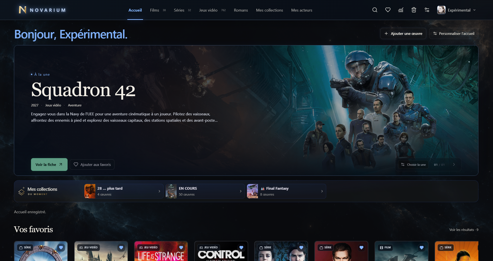

<h1 align="center">NOVARIUM</h1>

<strong>Explore Your Worlds</strong> Votre bibliothèque de films, séries, jeux vidéo et romans sur Windows.

<a href="https://github.com/Light-x02/Novarium/releases/latest">Télécharger NOVARIUM</a> · <a href="INSTALLATION.md">Guide d’installation</a> · <a href="ROADMAP.md">Feuille de route</a>

NOVARIUM est une application Windows gratuite et propriétaire. Organisez vos œuvres, retrouvez votre progression et partagez une collection ou sauvegardez un profil. Vos données sont conservées sur votre ordinateur.

**Version stable [0.51.1](https://github.com/Light-x02/Novarium/releases/tag/v0.51.1)** · **Windows 11 x64 testé** · [Prérequis et compatibilité](INSTALLATION.md#configuration-windows)

## Pour commencer

1. Téléchargez le ZIP depuis les [versions officielles](https://github.com/Light-x02/Novarium/releases/latest) et extrayez-le entièrement dans un dossier accessible en écriture.
2. Ouvrez `NOVARIUM.exe` depuis le dossier extrait. Gardez `_internal` et les autres ressources à côté du programme.
3. Créez un profil. Le **Guide de bienvenue et clés API** vous accompagne si vous souhaitez configurer les fournisseurs de métadonnées.

Vous utilisez déjà NOVARIUM ? Ouvrez **Paramètres → Mises à jour** pour rechercher la dernière version. Le [guide d’installation](INSTALLATION.md#mettre-à-jour) détaille le téléchargement, la migration et la vérification de signature.

## Ce que NOVARIUM organise

| Bibliothèque | Fonctions principales |
| --- | --- |
| **Films** | Affiches, synopsis, distribution, notes, favoris, suivi, fichiers vidéo locaux et offres de streaming. |
| **Séries** | Saisons et épisodes, progression, distribution, notes et suivi des nouvelles saisons. |
| **Jeux vidéo** | Jeux et DLC, métadonnées Steam, synchronisation facultative, installations, captures, succès, statuts de jeu et statistiques. |
| **Romans** | Livres papier et numériques, éditions, sagas, tomes et progression. L’import de fichiers ebooks est suspendu pendant la préparation de la refonte. |

Chaque profil dispose de son propre dossier de données et conserve ses collections, favoris et préférences. Les sauvegardes restent séparées et peuvent être restaurées depuis l’écran des profils. Une fois enregistrée, la bibliothèque est consultable hors ligne. La recherche de métadonnées, les visuels distants, les mises à jour et les synchronisations utilisent Internet. [Confidentialité](CONFIDENTIALITE.md) · [Conditions d’utilisation](MENTIONS_LEGALES.md)

## Nouveautés de la 0.51.1

- Retirez un profil indisponible du sélecteur en conservant ses fichiers. Les sauvegardes accessibles restent disponibles pour la restauration.
- Après un import IMDb, ouvrez la collection directement depuis le bilan. Les compteurs se mettent à jour pendant l’import.
- La synchronisation Steam préserve le temps de jeu connu si la durée manque. La vérification du QR code reprend après une interruption temporaire.
- Depuis le menu d’une affiche, choisissez de mettre la fiche à la corbeille ou de la supprimer définitivement après confirmation.

[Notes complètes de la 0.51.1](https://github.com/Light-x02/Novarium/releases/tag/v0.51.1)

## Sources et crédits

**Films et séries** via TMDB et IMDb via OMDb. **Jeux** via Steam, avec IGDB en recherche complémentaire. **Livres** via Google Books et Open Library. **Traduction facultative** via DeepL. Les disponibilités en France reposent sur TMDB/JustWatch. Certains fournisseurs nécessitent vos propres identifiants API.

NOVARIUM utilise l’API TMDB et bénéficie des données et illustrations de fournisseurs tiers. Les marques et visuels appartiennent à leurs titulaires. La [page des crédits et composants tiers](TIERS.md) détaille leurs conditions et licences.

## Aide et communauté

- Pour une question, consultez [Questions et aide](https://github.com/Light-x02/Novarium/discussions/categories/questions-et-aide).
- Pour une fonctionnalité, partagez votre proposition dans [Idées et suggestions](https://github.com/Light-x02/Novarium/discussions/categories/id%C3%A9es-et-suggestions).
- Pour un bug, [ouvrez un signalement](https://github.com/Light-x02/Novarium/issues/new) avec la version de NOVARIUM, la version de Windows et les étapes suivies. Anonymisez vos captures et gardez vos clés, jetons et sauvegardes privés.

Vous pouvez soutenir le développement depuis le lien **Soutenir NOVARIUM** dans l’application ou sur [Ko-fi](https://ko-fi.com/light_x02).

---

NOVARIUM · Créé par **Light_x02** · Logiciel propriétaire gratuit.
